<div align="center">

<picture>
  <source media="(prefers-color-scheme: dark)" srcset=".github/assets/banner-dark.svg">
  
</picture>

**Optional hardened native WebView for PAM Native.**<br>
Extracted from the PAM Native 1.46 core: WKWebView on iOS and Android WebView behind one PHP element, with host allowlists, injected scripts and page-to-PHP messages.

[](https://packagist.org/packages/pushinbr/pam-native-webview)
[](https://github.com/push-in/pam-native-webview/releases/latest)

[](LICENSE)

[Install](#install) · [Quick example](#quick-example) · [Platforms](#platform-support) · [API](#api) · [Docs](#docs) · [Issues](https://github.com/push-in/pam-native-webview/issues)

</div>

<a id="install"></a>
## <picture></picture> Install

Inside a PAM Native project (PAM Native 1.46 or later):

```sh
pam composer require pushinbr/pam-native-webview
pam doctor --fix
```

`pam composer` runs Composer on PAM's verified PHP runtime. Rebuild the native host after adding the package.

New to PAM? Create a project with `pam init my-app --template native` (see the [PAM Native overview](https://push-in.github.io/pam-docs/native/overview/)).

<a id="quick-example"></a>
## <picture></picture> Quick example

```php
use Pam\Native\WebView\WebView;

$view = WebView::make('https://example.com/app')
    ->allowedHosts(['example.com', 'cdn.example.com'])
    ->onMessage(function (string $message, string $url): void {
        // Posted by the page with window.PamNative.postMessage(text).
        // Check $url before trusting the message.
    })
    ->onError(function (string $message): void {
        // Error message reported by the native view.
    });
```

`WebView::make()` accepts an `https`, `http` or `file` URL or an inline HTML string (up to 1 MiB). JavaScript, DOM storage and inline media are on by default; turn them off with `javaScriptEnabled(false)`, `domStorageEnabled(false)` and `allowsInlineMedia(false)`. Pages written for react-native-webview can keep calling `window.ReactNativeWebView.postMessage(text)`. The host answers a page by changing `injectedJavaScript()`: a page that already loaded runs each new script once.

<a id="platform-support"></a>
## <picture></picture> Platform support

| Platform | Support | Notes |
| --- | --- | --- |
| Android | API 26+ | Platform WebView; no permissions declared |
| iOS | 15.0+ | WebKit, UIKit; Swift compilation and device QA still pending |
| PAM Native | 1.46.0 to < 2.0.0 | From `pam-native.plugin.json`; PHP 8.5+ |

<a id="api"></a>
## <picture></picture> API

| Method | Effect |
| --- | --- |
| `make(string $source)` | URL (`https`, `http`, `file`) or inline HTML, 1 byte to 1 MiB |
| `javaScriptEnabled(bool)`, `domStorageEnabled(bool)`, `allowsInlineMedia(bool)` | Default `true` |
| `userAgent(?string)` | Custom user agent; `null` restores the default |
| `injectedJavaScript(string)` | Script run on every load (at most 1 MiB) |
| `allowedHosts(list<string>)` | Navigation host allowlist |
| `scrollEnabled(bool)`, `overScrollMode(ScrollOverScrollMode)` | `scrollEnabled(false)` stops scrolling, bounce and over-scroll (full-screen pages such as games) |
| `onLoad(Closure)`, `onError(Closure(string))`, `onMessage(Closure(string $message, string $url))` | Native events |

<a id="core-extraction"></a>
## <picture></picture> Core extraction (1.46)

This capability moved out of the PAM Native core in 1.46. The core keeps deprecated PHP aliases through 1.46; they are removed in 1.47. Native wire contracts are retained, so existing pages keep working; migrate imports to `Pam\Native\WebView\WebView`.

<a id="docs"></a>
## <picture></picture> Docs

- [Changelog](CHANGELOG.md)
- [Extraction report (Portuguese)](RELATORIO.md)
- [PAM Native overview](https://push-in.github.io/pam-docs/native/overview/)
- [Report an issue](https://github.com/push-in/pam-native-webview/issues)

<a id="pam-ecosystem"></a>
## <picture></picture> Part of the PAM ecosystem

<p align="center"><picture>
  <source media="(prefers-color-scheme: dark)" srcset=".github/assets/pam-wordmark-dark.svg">
  
</picture></p>

PAM runs PHP natively on servers, desktops and phones. This repository is one piece of it.

| [**PAM**](https://github.com/push-in/pam) | [**PAM Desktop**](https://github.com/push-in/pam-desktop) | [**PAM Native**](https://github.com/push-in/pam-native) | [**Ecosystem**](https://github.com/push-in/pam#ecosystem) |
| --- | --- | --- | --- |
| the runtime and CLI | native desktop apps in PHP | native Android and iOS apps in PHP | every official package and plugin |

<sub>Docs: [push-in.github.io/pam-docs](https://push-in.github.io/pam-docs/introduction/) · [Issues](https://github.com/push-in/pam-native-webview/issues)</sub>

<p align="center"><sub><a href="LICENSE">Apache License 2.0</a> · Made in Brazil by Pushin</sub></p>
